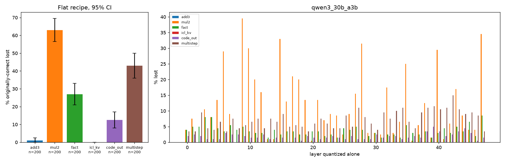
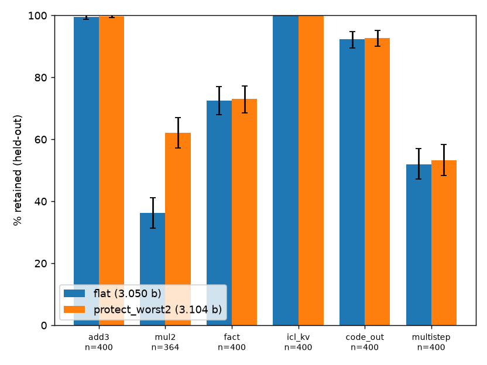

# InstinctRazor: capability-specific damage, and a 0.064-bit fix

[InstinctRazor](https://github.com/General-Instinct/InstinctRazor) is General Instinct's open-source sub-4-bit MoE quantizer. I tested its shipped flat recipe on a small MoE and scored each capability separately, instead of reporting one aggregate number. The damage is uneven. Factual recall breaks far more than arithmetic, and the damage is concentrated in the early layers, especially layer 0. Keeping layer 0 at higher precision (one new flag, `--protect-layers 0`) costs 0.064 bits per weight. On held-out items it recovers about 21 points of factual recall and 18 points of in-context lookup.


## Setup
- **Model:** `ibm-granite/granite-3.0-1b-a400m-base` (granitemoe: 24 layers, 32 experts, top-8, 1.3B total / 0.4B active). InstinctRazor supports this family (quant-only, marked experimental).
- **Quantizer:** InstinctRazor's own code, unchanged (commit `89bd8b8`): `GraniteMoeAdapter`, `moe_quant.fakequant` / `apply_ptq`, and `flat_spec`.
  - Recipe: INT3 routed experts, INT4 attention + embeddings/lm_head, BF16 router and norms, group 128, 16-step MSE clip search.
  - That comes to 48 expert tensors + 98 linears/embeds, **3.127 effective bits**.
  - No OPD recovery step was run.
- **Suites:** greedy decoding, exact-prefix match.
  - 3-shot 2-digit addition
  - CounterFact subject→object recall
  - 6-pair word=number lookup inside the prompt
- **Metric:** share of the items the *original* model answered correctly (up to 200 per suite) that the compressed model still answers. CIs are 95% bootstrap, 10k resamples.
- **Kill condition (set in advance):** if every per-capability drop is within CI of the others, report that capability-specific damage was not found.

## Results
### 1. Damage differs by capability (`results/analysis.json`)
| capability | n | lost after flat recipe |
|---|---|---|
| factual recall (CounterFact) | 97 | 59.8% [49.5, 70.1] |
| in-context key-value lookup | 200 | 27.5% [21.5, 34.0] |
| 2-digit addition | 200 | 19.0% [13.5, 24.5] |

- Pairwise drop differences (95% CI): arith-fact: -40.8 [-51.9, -29.6]; arith-icl_kv: -8.5 [-17.0, -0.5]; fact-icl_kv: +32.3 [+20.5, +43.9].
- **Kill condition fired: False.** The damage is capability-specific.

### 2. Where the damage sits (per-layer scan: quantize one layer, keep the rest BF16)
- **Recall:** worst at layer 0 (20.6% lost), then layer 1 (13.4%).
- **Other capabilities:** any single layer costs addition at most 1.0% and lookup at most 6.0%.
- **Rankings disagree:** layer rankings differ across capabilities (Spearman: arith-fact -0.30, arith-icl_kv -0.07, fact-icl_kv 0.06).

### 3. Protection variants on the discovery items (`results/fix.json`, % retained)
| variant | eff. bits | addition | recall | lookup |
|---|---|---|---|---|
| baseline_flat | 3.127 | 81.0 | 40.2 | 72.5 |
| embed_bf16 | 4.000* | 78.5 | 50.5 | 86.5 |
| layer0_protected | 3.191 | 91.0 | 54.6 | 86.0 |
| embed_bf16+layer0 | 4.064* | 92.0 | 57.7 | 91.0 |
| embed_bf16+layers0-2_int4exp | 4.109* | 88.0 | 53.6 | 93.0 |
| all_experts_int4 | 4.000 | 92.0 | 54.6 | 70.0 |

\*Granite ties embed and lm_head, and InstinctRazor's `effective_bits` counts both, so the embed rows overstate the cost.

Protecting layer 0 gives the best accuracy per bit. Moving every expert to INT4 costs about 13× more bits and gives no lookup gain over flat.

### 4. The fix, validated on fresh held-out items (`results/heldout_analysis.json`)
- Held-out items: new seed, disjoint CounterFact slice 700–2500.
- Code path: the patched `flat_spec(protect_layers=(0,))`.
- Paired bootstrap gain:

| capability | n | flat (3.127 b) | `--protect-layers 0` (3.191 b) | gain |
|---|---|---|---|---|
| factual recall (CounterFact) | 239 | 36.4% | 57.3% | +20.9 pts [+15.5, +26.8] |
| in-context key-value lookup | 268 | 78.0% | 96.3% | +18.3 pts [+13.4, +23.1] |
| 2-digit addition | 299 | 82.9% | 88.3% | +5.4 pts [+1.3, +9.4] |


## Qwen3-30B-A3B-Base (GPU run, `results_qwen3/`)

Same suites plus multiplication, code-output and 2-step reasoning; same InstinctRazor recipe (INT3 experts / INT4 attention, group 128, 16-step clip search) via `bigrun/bigrun.py`, transformers 5.9 on 1x A100 80GB PCIe. Discovery n = 200 correct items per suite; 95% bootstrap CIs (10k). All numbers below are generated from `results_qwen3/analysis.json` and `results_qwen3/perlayer_worst_ci.json`.



### Flat recipe (3.050 effective bits), % of originally-correct items lost

| capability | n | lost |
|---|---|---|
| 3-digit addition | 200 | 1.0% [0.0, 2.5] |
| 2-digit multiplication | 200 | 63.0% [56.5, 69.5] |
| factual recall (CounterFact) | 200 | 27.0% [21.0, 33.0] |
| in-context key-value lookup | 200 | 0.0% [0.0, 0.0] |
| Python output prediction | 200 | 12.5% [8.0, 17.0] |
| 2-step word problems | 200 | 43.0% [36.0, 50.0] |

Kill condition fired: **False**. Damage is capability-specific again, but the ranking changed: multiplication and multi-step reasoning break most, recall less than on Granite.

### Per-layer scan (quantize one layer alone, all 48 layers)

| capability | worst layer | lost at worst layer | lost at layer 0 |
|---|---|---|---|
| 3-digit addition | none (0 loss at every layer) | 0.0% | 0.0% |
| 2-digit multiplication | 9 | 39.5% [33.0, 46.5] | 4.0% [1.5, 7.0] |
| factual recall (CounterFact) | 47 | 8.5% [5.0, 12.5] | 4.0% [1.5, 7.0] |
| in-context key-value lookup | none (0 loss at every layer) | 0.0% | 0.0% |
| Python output prediction | 39 | 5.0% [2.0, 8.5] | 2.0% [0.5, 4.0] |
| 2-step word problems | 42 | 15.0% [10.0, 20.0] | 3.5% [1.0, 6.0] |

- **Layer 0 is not the worst layer for recall on Qwen3.** Recall's worst single layer is 47 (8.5%); layer 0 costs 4.0%. The paired difference (L47 minus L0) is 4.5 pts [0.0, 9.0] at n=200, so the two are only marginally separable, and several layers (3, 4, 47) sit at 8-8.5%. The Granite finding "layer 0 is the hot spot" does not transfer.
- Per-layer rankings barely agree across capabilities (Spearman: mul2-fact 0.19, mul2-code_out -0.07, mul2-multistep -0.14, fact-code_out 0.09, fact-multistep -0.16, code_out-multistep 0.10; pairs involving addition/lookup are undefined because those suites lose nothing at any single layer).

### Protection variants on discovery items (% retained, n=200 each)

| variant | eff. bits | add3 | mul2 | fact | icl_kv | code_out | multistep |
|---|---|---|---|---|---|---|---|
| flat | 3.050 | 99.0 | 37.0 | 73.0 | 100.0 | 87.5 | 57.0 |
| protect_L0 | 3.077 | 99.0 | 36.0 | 77.0 | 100.0 | 85.5 | 58.5 |
| protect_worst1_L9 | 3.077 | 99.0 | 52.0 | 75.5 | 100.0 | 85.5 | 56.5 |
| protect_worst2 | 3.104 | 99.0 | 63.5 | 73.0 | 100.0 | 86.0 | 57.5 |

`protect_worst2` keeps layers 9 and 47 (the two worst by mean per-layer drop) at INT4 experts / BF16 attention.

### Held-out validation: flat (3.050 b) vs `protect_worst2` (3.104 b)

Fresh items (seed 1, disjoint CounterFact slice), up to 400 base-correct items per suite; paired bootstrap.

| capability | n | flat | fix | gain |
|---|---|---|---|---|
| 3-digit addition | 400 | 99.5% | 99.8% | +0.2 pts [-0.5, +1.2] |
| 2-digit multiplication | 364 | 36.3% | 62.1% | +25.8 pts [+21.4, +30.5] |
| factual recall (CounterFact) | 400 | 72.5% | 73.0% | +0.5 pts [-2.5, +3.5] |
| in-context key-value lookup | 400 | 100.0% | 100.0% | +0.0 pts [+0.0, +0.0] |
| Python output prediction | 400 | 92.2% | 92.8% | +0.5 pts [-1.0, +2.0] |
| 2-step word problems | 400 | 52.0% | 53.2% | +1.2 pts [-1.5, +4.0] |

- For +0.054 bits, protecting two layers recovers about 26 points of multiplication on held-out items. Every other gain's CI includes zero.



### Qwen3 limitations
- One run, one seed per item set; n=200 discovery / up to 400 held-out (multiplication held-out n=364 because the base model only got 364 of 1000 right).
- Discovery n was cut from the planned 400 to 200 and OLMoE was dropped to fit a $4.39 GPU budget (see `bigrun/PLAN.md`).
- The protected layers were chosen on the discovery items, so only the held-out table is an unbiased estimate of the fix; the choice optimises mean drop, which multiplication dominates.
- Flat-recipe retention on 'fact' (73%) means 27% of recall items are lost by the full recipe even though no single layer costs more than 8.5%: damage compounds across layers.
- No OPD recovery stage, no GGUF, base (not instruct) model; the per-layer CIs are from bootstrap over items, not over reruns, and GPU kernels can be slightly nondeterministic.

## The patch
`patch/0001-quant_save-protect-layers-keeps-chosen-decoder-layer.patch` applies to InstinctRazor `89bd8b8` with `git am`.
- `flat_spec(..., protect_layers=(), protect_expert_bits=4.0, protect_linear_bits=16)` keeps the listed decoder layers' experts at INT4 and their attention/backbone linears at BF16.
- New flags: `quant_save.py --protect-layers 0 [--protect-expert-bits 4 --protect-linear-bits 16]`.
- With no layers listed, it returns the original spec unchanged.

## Limitations
- **Scale:** one small model, in a family InstinctRazor marks experimental. On Qwen3-30B-A3B (section above) layer 0 is *not* the hot spot; nothing here covers Qwen3.5-122B. OLMoE was not run.
- **Not tested:**
  - the OPD recovery stage (it might close part of the gap)
  - the published IQ3_XXS GGUF, which uses a different quantizer
  - code, instruction-following and reasoning suites
  - per-expert localization
- **Selection:** layer 0 was picked on the discovery items. That is why the fix is re-measured on held-out items.
- **Interaction:** quantizing layer 0 *alone* barely hurts lookup, yet protecting it within the full recipe recovers +18 points. The damage compounds across layers rather than adding up.
- **Sample size:** recall n is small (97 discovery / 239 held-out) because the base model knows only ~14% of CounterFact.
- **Noise:** CPU bf16 runs are slightly nondeterministic between reloads. All before/after comparisons are paired within one run.
- **Environment:** transformers 4.46 on CPU. InstinctRazor's own test suite targets 5.x and was not run.

## Reproduce (CPU is enough, about 50 min on 8 cores)
```bash
git clone https://github.com/General-Instinct/InstinctRazor && (cd InstinctRazor && git checkout 89bd8b8 && git am ../patch/0001-*.patch)
mkdir -p data && curl -Lo data/counterfact.json https://rome.baulab.info/data/dsets/counterfact.json
pip install torch "transformers==4.46.3" numpy scipy matplotlib
python scripts/run.py && python scripts/fix.py && python scripts/heldout.py   # writes results/*.json
python scripts/analyze.py && python scripts/fix_analyze.py                   # writes analysis JSON + charts
```
Environment overrides: `IR_SRC` (InstinctRazor `src/quant` dir), `COUNTERFACT`, `OUT_DIR`.

## Files
- `scripts/`: experiment and analysis code
- `results/`: raw per-item results (`items.json`, `perlayer_items.json`, `compressed.json`, `fix.json`, `heldout.json`), analysis JSON, run logs
- `chart.png`, `fix_chart.png`
- `results_qwen3/`, `qwen3_chart.png`, `qwen3_fix_chart.png`: Qwen3-30B-A3B-Base GPU run
- `patch/`
- `bigrun/`: GPU plan and script for larger MoEs

CounterFact is from Meng et al., "Locating and Editing Factual Associations in GPT" (ROME), https://arxiv.org/abs/2202.05262. It is not redistributed here. InstinctRazor is Apache-2.0, © General Instinct. This is an independent evaluation.
