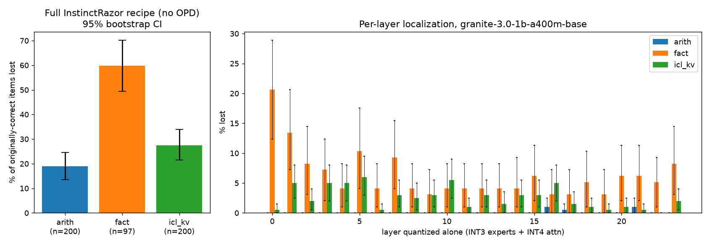
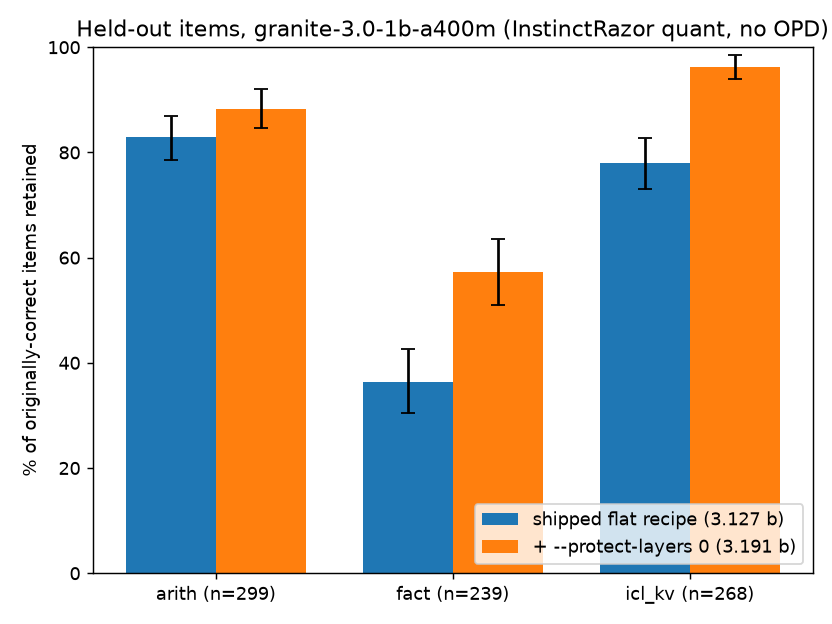

# InstinctRazor: capability-specific damage, and a 0.064-bit fix

[InstinctRazor](https://github.com/General-Instinct/InstinctRazor) is General Instinct's open-source sub-4-bit MoE quantizer. I tested its shipped flat recipe on a small MoE and scored each capability separately, instead of reporting one aggregate number. The damage is uneven. Factual recall breaks far more than arithmetic, and the damage is concentrated in the early layers, especially layer 0. Keeping layer 0 at higher precision (one new flag, `--protect-layers 0`) costs 0.064 bits per weight. On held-out items it recovers about 21 points of factual recall and 18 points of in-context lookup.



## Setup
- **Model:** `ibm-granite/granite-3.0-1b-a400m-base` (granitemoe: 24 layers, 32 experts, top-8, 1.3B total / 0.4B active). InstinctRazor supports this family (quant-only, marked experimental).
- **Quantizer:** InstinctRazor's own code, unchanged (commit `89bd8b8`): `GraniteMoeAdapter`, `moe_quant.fakequant` / `apply_ptq`, and `flat_spec`.
  - Recipe: INT3 routed experts, INT4 attention + embeddings/lm_head, BF16 router and norms, group 128, 16-step MSE clip search.
  - That comes to 48 expert tensors + 98 linears/embeds, **3.127 effective bits**.
  - No OPD recovery step was run.
- **Suites:** greedy decoding, exact-prefix match.
  - 3-shot 2-digit addition
  - CounterFact subject→object recall
  - 6-pair word=number lookup inside the prompt
- **Metric:** share of the items the *original* model answered correctly (up to 200 per suite) that the compressed model still answers. CIs are 95% bootstrap, 10k resamples.
- **Kill condition (set in advance):** if every per-capability drop is within CI of the others, report that capability-specific damage was not found.

## Results
### 1. Damage differs by capability (`results/analysis.json`)
| capability | n | lost after flat recipe |
|---|---|---|
| factual recall (CounterFact) | 97 | 59.8% [49.5, 70.1] |
| in-context key-value lookup | 200 | 27.5% [21.5, 34.0] |
| 2-digit addition | 200 | 19.0% [13.5, 24.5] |

- Pairwise drop differences (95% CI): arith-fact: -40.8 [-51.9, -29.6]; arith-icl_kv: -8.5 [-17.0, -0.5]; fact-icl_kv: +32.3 [+20.5, +43.9].
- **Kill condition fired: False.** The damage is capability-specific.

### 2. Where the damage sits (per-layer scan: quantize one layer, keep the rest BF16)
- **Recall:** worst at layer 0 (20.6% lost), then layer 1 (13.4%).
- **Other capabilities:** any single layer costs addition at most 1.0% and lookup at most 6.0%.
- **Rankings disagree:** layer rankings differ across capabilities (Spearman: arith-fact -0.30, arith-icl_kv -0.07, fact-icl_kv 0.06).

### 3. Protection variants on the discovery items (`results/fix.json`, % retained)
| variant | eff. bits | addition | recall | lookup |
|---|---|---|---|---|
| baseline_flat | 3.127 | 81.0 | 40.2 | 72.5 |
| embed_bf16 | 4.000* | 78.5 | 50.5 | 86.5 |
| layer0_protected | 3.191 | 91.0 | 54.6 | 86.0 |
| embed_bf16+layer0 | 4.064* | 92.0 | 57.7 | 91.0 |
| embed_bf16+layers0-2_int4exp | 4.109* | 88.0 | 53.6 | 93.0 |
| all_experts_int4 | 4.000 | 92.0 | 54.6 | 70.0 |

\*Granite ties embed and lm_head, and InstinctRazor's `effective_bits` counts both, so the embed rows overstate the cost.

Protecting layer 0 gives the best accuracy per bit. Moving every expert to INT4 costs about 13× more bits and gives no lookup gain over flat.

### 4. The fix, validated on fresh held-out items (`results/heldout_analysis.json`)
- Held-out items: new seed, disjoint CounterFact slice 700–2500.
- Code path: the patched `flat_spec(protect_layers=(0,))`.
- Paired bootstrap gain:

| capability | n | flat (3.127 b) | `--protect-layers 0` (3.191 b) | gain |
|---|---|---|---|---|
| factual recall (CounterFact) | 239 | 36.4% | 57.3% | +20.9 pts [+15.5, +26.8] |
| in-context key-value lookup | 268 | 78.0% | 96.3% | +18.3 pts [+13.4, +23.1] |
| 2-digit addition | 299 | 82.9% | 88.3% | +5.4 pts [+1.3, +9.4] |



## The patch
`patch/0001-quant_save-protect-layers-keeps-chosen-decoder-layer.patch` applies to InstinctRazor `89bd8b8` with `git am`.
- `flat_spec(..., protect_layers=(), protect_expert_bits=4.0, protect_linear_bits=16)` keeps the listed decoder layers' experts at INT4 and their attention/backbone linears at BF16.
- New flags: `quant_save.py --protect-layers 0 [--protect-expert-bits 4 --protect-linear-bits 16]`.
- With no layers listed, it returns the original spec unchanged.

## Limitations
- **Scale:** one small model, in a family InstinctRazor marks experimental. Nothing here shows layer 0 is also the hot spot for Qwen3.5-122B; `bigrun/` is the plan to test Qwen3-30B-A3B and OLMoE on one GPU.
- **Not tested:**
  - the OPD recovery stage (it might close part of the gap)
  - the published IQ3_XXS GGUF, which uses a different quantizer
  - code, instruction-following and reasoning suites
  - per-expert localization
- **Selection:** layer 0 was picked on the discovery items. That is why the fix is re-measured on held-out items.
- **Interaction:** quantizing layer 0 *alone* barely hurts lookup, yet protecting it within the full recipe recovers +18 points. The damage compounds across layers rather than adding up.
- **Sample size:** recall n is small (97 discovery / 239 held-out) because the base model knows only ~14% of CounterFact.
- **Noise:** CPU bf16 runs are slightly nondeterministic between reloads. All before/after comparisons are paired within one run.
- **Environment:** transformers 4.46 on CPU. InstinctRazor's own test suite targets 5.x and was not run.

## Reproduce (CPU is enough, about 50 min on 8 cores)
```bash
git clone https://github.com/General-Instinct/InstinctRazor && (cd InstinctRazor && git checkout 89bd8b8 && git am ../patch/0001-*.patch)
mkdir -p data && curl -Lo data/counterfact.json https://rome.baulab.info/data/dsets/counterfact.json
pip install torch "transformers==4.46.3" numpy scipy matplotlib
python scripts/run.py && python scripts/fix.py && python scripts/heldout.py   # writes results/*.json
python scripts/analyze.py && python scripts/fix_analyze.py                   # writes analysis JSON + charts
```
Environment overrides: `IR_SRC` (InstinctRazor `src/quant` dir), `COUNTERFACT`, `OUT_DIR`.

## Files
- `scripts/`: experiment and analysis code
- `results/`: raw per-item results (`items.json`, `perlayer_items.json`, `compressed.json`, `fix.json`, `heldout.json`), analysis JSON, run logs
- `chart.png`, `fix_chart.png`
- `patch/`
- `bigrun/`: GPU plan and script for larger MoEs

CounterFact is from Meng et al., "Locating and Editing Factual Associations in GPT" (ROME), https://arxiv.org/abs/2202.05262. It is not redistributed here. InstinctRazor is Apache-2.0, © General Instinct. This is an independent evaluation.
